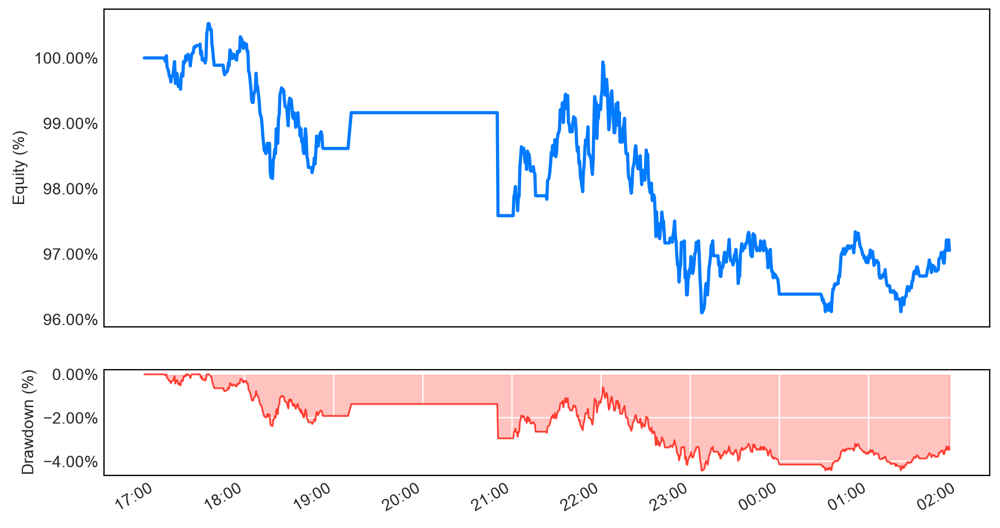

## Risk 13 Intraday Risk Engine

This repo is an intraday risk engine to assist with risk management for my discretionary manual trading. The Python package mt5-mac is used to communicate with MetaTrader 5 running on my MacBook through Wine wrapper. I do not want to use a VPS or some API service to do it. I just want to run it locally on my macOS laptop.

So I use the mt5-mac package. Some minor modifications have to be made to work on my laptop and the mt5_mac folder has the modified package. You can find out more about mt5-mac package here [pypi.org/project/mt5-mac](https://pypi.org/project/mt5-mac). The package links to dead URLs on GitHub and the author's email is invalid too, not sure why.

For the risk engine, you can see source code at [risk_engine.py](https://github.com/street13capital/mt5_mac/blob/main/risk_engine.py) and its various parameters. IMPORTANT - every trader is different. To use a risk engine effectively, the trader needs to enable features that he wants and set parameters that work for him. The engine can be adapted to work with other brokerages for eg IBKR APIs.

### Key features of the risk engine

|Feature|Description|
|:------|:----------|
|automated cut loss |cut open positions if unrealised loss exceeds trade risk limit|
|distributed daily risk|risk allocation spread over different trading sessions in the day|
|trailing daily risk|close positions if exceed daily risk limit marked to peak balance|
|trailing weekly risk|close positions if exceed weekly risk limit marked to peak balance|
|next trade size|display next trade size accounting for remaining daily risk limit|
|breakeven stop|get out of trades if they hit +0.5R and come back to breakeven|
|profit target stops|lock profits if trades retrace below +1.0R, +1.5R, +2.0R targets|
|protective stops|progressively tighten stops at +2.5R, +4.0R, +6.5R milestones|
|tighter cut loss|default option to cut at half trade risk instead of full trade risk|
|outside capital|allow risk calculations where not all capital is in MT5 account|
|equity curve|log intraday equity for live viewing of trading or EOD review|

### Sample output of the risk engine

```
[Risk 13 Engine]
Maximum: 1234.56
Current: 1177.42
Equity:  1168.11
P&L:     -9.31
Size:    0.3
```

### Sample intraday equity curve




### Sample of mt5-mac package

For the mt5-mac package, below is a minimal demo script to initialise, get account info, and end execution. The windows_terminal_path step is needed to make it work vs leaving it as default.

```py
import mt5_mac as mt5
windows_terminal_path = "C:/Program Files/MetaTrader 5/terminal64.exe"

mt5.initialize(path=windows_terminal_path)
mt5.login(1234567, "password", "server")

print(mt5.account_info())
# do whatever work needed to be done here
# API at https://pypi.org/project/mt5-mac/

mt5.shutdown()
```
