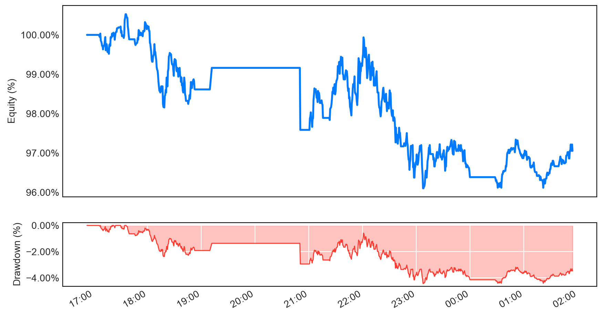

## Risk 13 Intraday Risk Engine

This repo is an intraday risk engine to assist with risk management for my discretionary manual trading. The Python package [mt5-mac](https://pypi.org/project/mt5-mac) is used to communicate with MetaTrader 5 running on my MacBook through Wine wrapper. You can see source code for the risk engine at [risk_engine.py](https://github.com/street13capital/mt5_mac/blob/main/risk_engine.py) and its various parameters.

### Features of the risk engine

|Risk Management|Description|
|:--------------|:----------|
|automated cut loss |cut open positions if unrealised loss exceeds trade risk limit|
|distributed daily risk|optional risk spread over different trading sessions in the day|
|trailing daily risk|close positions if exceed daily risk limit marked to peak balance|
|trailing weekly risk|close positions if exceed weekly risk limit marked to peak balance|
|tighter cut loss|optional setting to cut at 38.2% of trade risk instead of full risk|
|disable adding|default setting to cap risk by not allowing adding to trades|

|Trade Management|Description|
|:---------------|:----------|
|breakeven stop|get out of trades if they hit +0.382R and return to breakeven|
|profit target stops|lock profits if reverse below +0.618R, +0.786R, +1.0R, +1.25R|
|protective stops|tighten stop at +1.5R, tighten even more at +4.0R and +6.5R|
|multiple positions|stops and risk limits work for multiple concurrent symbols|

|Order Management|Description|
|:---------------|:----------|
|watchlist support|define trade symbols with their lot size and stop loss points|
|default symbols|parameters defined for BTCUSD, EURUSD, XAUUSD, USTEC|
|order shortcuts|send buy, close, sell auto-sized orders with 'b', 'n', 'm' keys|
|cut % shortcut|set cut loss to 25%, 50%, 100% of trade risk with ',./' keys|
|flip shortcut|reverse trade direction using the default risk sizing with 'j' key|
|on/off stops|on/off profit and protective stops with 'k' key (breakeven intact)|
|unwind shortcut|unwind least profitable position top of trade stack with 'h' key|
|flatten shortcut|emergency flattening of all positions with 'x' key (be careful)|
|next trade size|show next trade size accounting for remaining daily risk limit|

|Other Features|Description|
|:-------------|:----------|
|outside capital|allow risk calculations where not all capital is in MT5 account|
|equity curve|log intraday equity for live viewing of trading or EOD review|
|hide balance|option to hide max balance, balance and equity now for focus|
|swing trading|swing trading mode where only weekly risk limit is imposed|
|swing budget|show risk budget in swing trading, factoring stop losses|
|micro trading|option to trade at 1/10 size for testing and development|
|anti-sleep|prevent laptop sleeping while running, display will go off|

### Sample output of risk engine

```
[Risk 13 x EURUSD]
Maximum: 12346.56
Current: 11776.42
Equity:  11686.11
P&L:     -90.31
Size:    3.0
```

### Sample intraday equity curve



### Sample of mt5-mac package

For the mt5-mac package, some minor modifications have to be made to work on my laptop and the mt5_mac folder has the modified package. You can find out more about mt5-mac package here [pypi.org/project/mt5-mac](https://pypi.org/project/mt5-mac). The package links to dead URLs on GitHub and the author's email is invalid too, not sure why.

Below is a minimal demo script to initialise, get account info, and end execution.

```py
import mt5_mac as mt5

# this windows_terminal_path assignment is needed to make it work
windows_terminal_path = "C:/Program Files/MetaTrader 5/terminal64.exe"

mt5.initialize(path=windows_terminal_path)
mt5.login(1234567, "password", "server")

print(mt5.account_info())
# do whatever work needed to be done here
# API at https://pypi.org/project/mt5-mac/

mt5.shutdown()
```
